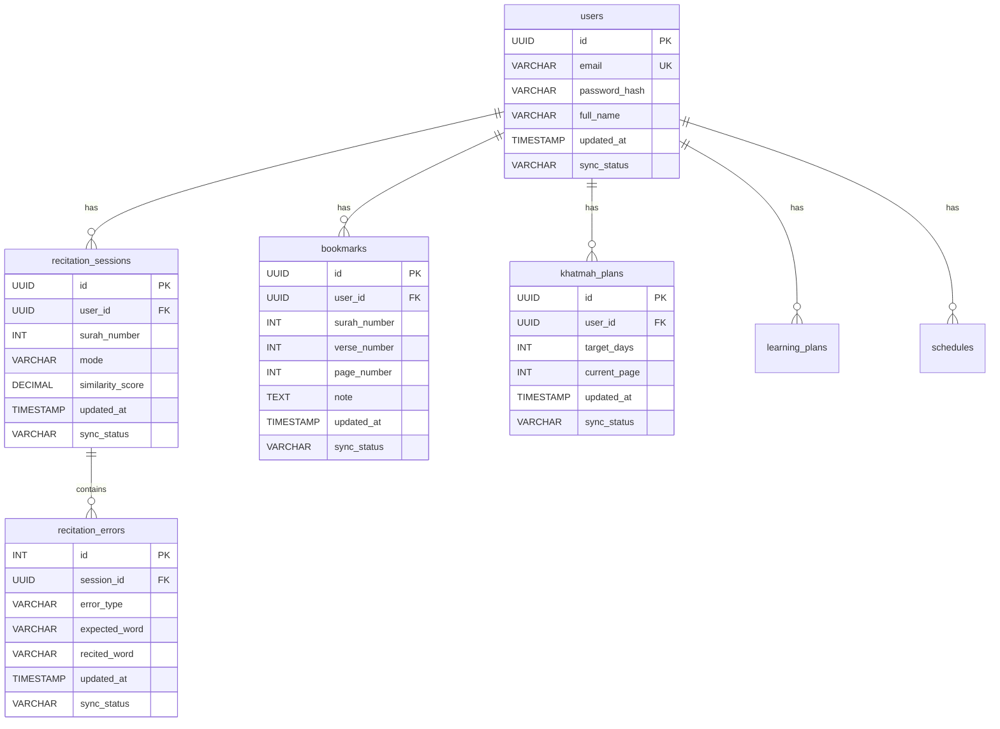

# Qurany Backend Database Schema (PostgreSQL)

This document outlines the proposed database structure for the Qurany app. Since Quranic text, audio, and tafsir are fetched on-the-fly via APIs (e.g. Alquran.cloud / Quran.com API), our local PostgreSQL database will exclusively focus on **User Profile**, **Progression**, **Plans**, and **Historical Data**.

## Technical Decisions (Based on User Feedback)
1. **Backend Framework:** FastAPI.
2. **Authentication:** FastAPI's native OAuth2 with JWT. We will keep the `users` table to store the `password_hash`.
3. **Sync Strategy:** Offline-first. All relevant tables will have `updated_at` and `sync_status` (or `is_deleted` flag) to allow conflict resolution and syncing with local SQLite/SharedPreferences.

## Database Entity-Relationship Diagram



---

## Proposed Changes (Database Tables)

### 1. `users` Table
Stores authentication and basic user profile information.

```sql
CREATE TABLE users (
    id UUID PRIMARY KEY DEFAULT uuid_generate_v4(),
    email VARCHAR(255) UNIQUE NOT NULL,
    password_hash VARCHAR(255) NOT NULL,
    full_name VARCHAR(255),
    daily_streak INT DEFAULT 0,
    total_score INT DEFAULT 0,
    created_at TIMESTAMP WITH TIME ZONE DEFAULT NOW(),
    updated_at TIMESTAMP WITH TIME ZONE DEFAULT NOW(),
    sync_status VARCHAR(20) DEFAULT 'synced',
    is_deleted BOOLEAN DEFAULT FALSE
);
```

---

### 2. `recitation_sessions` Table
Maps to `RecitationSession` model. Tracks every recitation or memorization session.

```sql
CREATE TABLE recitation_sessions (
    id UUID PRIMARY KEY DEFAULT uuid_generate_v4(),
    user_id UUID REFERENCES users(id) ON DELETE CASCADE,
    surah_number INT NOT NULL,
    mode VARCHAR(50) NOT NULL, -- 'free' or 'memorization'
    similarity_score DECIMAL(5,2), -- AI evaluation score (e.g., 95.50)
    total_words INT DEFAULT 0,
    matched_words INT DEFAULT 0,
    mistakes INT DEFAULT 0,
    verses_recited INT DEFAULT 0,
    transcribed_text TEXT,
    reference_text TEXT,
    created_at TIMESTAMP WITH TIME ZONE DEFAULT NOW(),
    updated_at TIMESTAMP WITH TIME ZONE DEFAULT NOW(),
    sync_status VARCHAR(20) DEFAULT 'synced',
    is_deleted BOOLEAN DEFAULT FALSE
);
```

---

### 3. `recitation_errors` Table
Maps to `RecitationError` model. A breakdown of specific mistakes made during a session to allow the user to review them later.

```sql
CREATE TABLE recitation_errors (
    id SERIAL PRIMARY KEY,
    session_id UUID REFERENCES recitation_sessions(id) ON DELETE CASCADE,
    error_type VARCHAR(50) NOT NULL, -- 'substitution', 'omission', 'addition', 'sequence'
    expected_word VARCHAR(255),
    recited_word VARCHAR(255),
    word_index INT,
    created_at TIMESTAMP WITH TIME ZONE DEFAULT NOW(),
    updated_at TIMESTAMP WITH TIME ZONE DEFAULT NOW(),
    sync_status VARCHAR(20) DEFAULT 'synced',
    is_deleted BOOLEAN DEFAULT FALSE
);
```

---

### 4. `bookmarks` Table
Maps to `Bookmark` model. Tracks both Page bookmarks and exact Ayah bookmarks with notes.

```sql
CREATE TABLE bookmarks (
    id UUID PRIMARY KEY DEFAULT uuid_generate_v4(),
    user_id UUID REFERENCES users(id) ON DELETE CASCADE,
    surah_number INT,
    verse_number INT,
    page_number INT, -- Nullable. If populated, it's a page bookmark
    note TEXT,
    created_at TIMESTAMP WITH TIME ZONE DEFAULT NOW(),
    updated_at TIMESTAMP WITH TIME ZONE DEFAULT NOW(),
    sync_status VARCHAR(20) DEFAULT 'synced',
    is_deleted BOOLEAN DEFAULT FALSE
);
```

---

### 5. `khatmah_plans` Table
Maps to `KhatmahPlan` model. Tracks the reading schedule (الورد).

```sql
CREATE TABLE khatmah_plans (
    id UUID PRIMARY KEY DEFAULT uuid_generate_v4(),
    user_id UUID REFERENCES users(id) ON DELETE CASCADE,
    target_days INT, -- Nullable (if open-ended)
    start_page INT DEFAULT 1,
    end_page INT DEFAULT 604,
    current_page INT DEFAULT 1,
    last_read_date TIMESTAMP WITH TIME ZONE,
    created_at TIMESTAMP WITH TIME ZONE DEFAULT NOW(),
    updated_at TIMESTAMP WITH TIME ZONE DEFAULT NOW(),
    sync_status VARCHAR(20) DEFAULT 'synced',
    is_deleted BOOLEAN DEFAULT FALSE
);
```

---

### 6. `learning_plans` Table
Maps to `LearningPlan` model. For tracking specific memorization or learning paths across multiple Surahs/Juzs.

```sql
CREATE TABLE learning_plans (
    id UUID PRIMARY KEY DEFAULT uuid_generate_v4(),
    user_id UUID REFERENCES users(id) ON DELETE CASCADE,
    title VARCHAR(255) NOT NULL,
    plan_type VARCHAR(50) NOT NULL, -- 'memorization', 'revision', etc.
    start_date DATE NOT NULL,
    end_date DATE,
    progress_percentage DECIMAL(5,2) DEFAULT 0.0,
    created_at TIMESTAMP WITH TIME ZONE DEFAULT NOW(),
    updated_at TIMESTAMP WITH TIME ZONE DEFAULT NOW(),
    sync_status VARCHAR(20) DEFAULT 'synced',
    is_deleted BOOLEAN DEFAULT FALSE
);
```

---

### 7. `schedules` Table
Maps to `Schedule` model. Configures notification and routine alerts.

```sql
CREATE TABLE schedules (
    id UUID PRIMARY KEY DEFAULT uuid_generate_v4(),
    user_id UUID REFERENCES users(id) ON DELETE CASCADE,
    title VARCHAR(255) NOT NULL,
    schedule_type VARCHAR(50), -- e.g. 'daily_recitation', 'khatmah_reminder'
    time_hh_mm VARCHAR(5) NOT NULL, -- Format 'HH:MM'
    days_of_week INT[], -- Array of integers representing days [1,2,3,4,5,6,7]
    is_active BOOLEAN DEFAULT TRUE,
    created_at TIMESTAMP WITH TIME ZONE DEFAULT NOW(),
    updated_at TIMESTAMP WITH TIME ZONE DEFAULT NOW(),
    sync_status VARCHAR(20) DEFAULT 'synced',
    is_deleted BOOLEAN DEFAULT FALSE
);
```

## Next Steps
Since you approved the schema:
1. We will set up a FastAPI project directory.
2. Configure SQLAlchemy ORM to map these PostgreSQL tables.
3. Build the initial FastAPI OAuth2 authentication flow.
